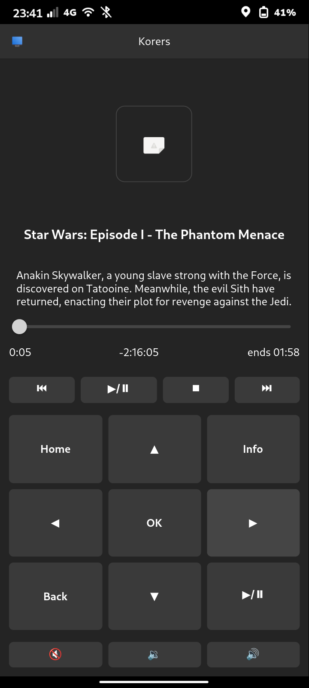
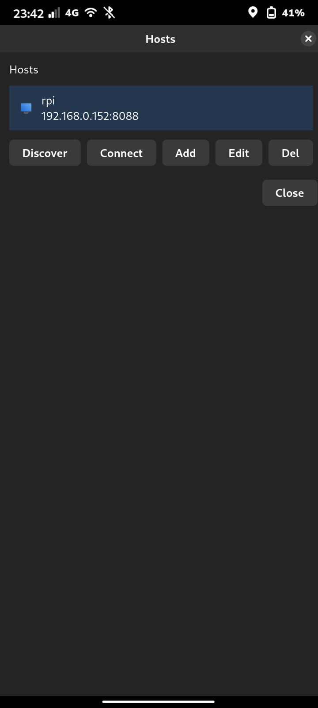

# Korers

A Rust desktop remote control application for Kodi, built with Relm4 and GTK4 on Linux.

## Overview

Korers is an alternative to the official Kodi remote apps (Kore, etc.) designed specifically for Linux desktop environments. It provides a native GTK4 interface for controlling your Kodi media center.

## Features

### Host Management
- Auto-discovery of Kodi instances via UDP broadcast (SSDP)
- Manual host addition with custom address, port, and credentials
- Persistent host configuration

### Remote Control
- D-pad navigation (up/down/left/right/select)
- Transport controls (play/pause/stop/previous/next)
- Volume control with mute toggle
- Context menu, info, back, and home buttons

### Now Playing
- Current media info display (title, artist, album)
- Album art/thumbnail display
- Progress bar with seek capability

### MPRIS / Lock Screen Controls
- Exposes playback over D-Bus as `org.mpris.MediaPlayer2.korers`
- Works with Phosh/GNOME/KDE media widgets and `playerctl`
- Play, pause, stop, next, previous, seek, and volume control from the lock screen
- Track metadata and cached artwork for the media widget
- Driven by the existing local ticker; MPRIS adds no background Kodi polling

Try it from a terminal:

```bash
playerctl --player=korers status
playerctl --player=korers metadata
playerctl --player=korers play-pause
```

## Tech Stack

- **UI Framework**: Relm4 + GTK4
- **Async Runtime**: Tokio
- **HTTP Client**: Reqwest
- **Serialization**: Serde
- **Discovery**: dns-sd (SSDP)
- **MPRIS**: zbus (D-Bus)
- **Logging**: tracing

## Building

```bash
cargo build --release
```

## Running

```bash
cargo run --release
```

Or install the binary and run:
```bash
cargo install --path .
korers
```

## Configuration

Hosts are stored in `~/.config/korers/hosts.json`.

## License

GPLv3

## Screenshots




